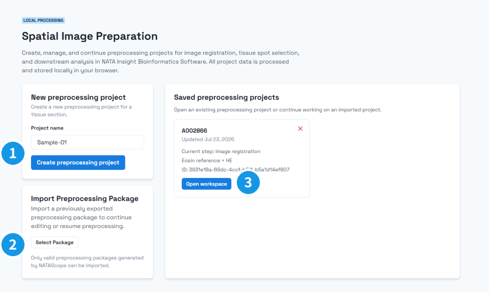
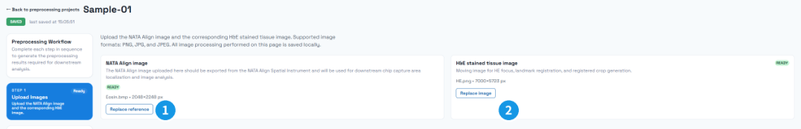
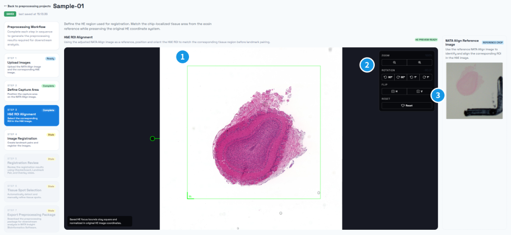
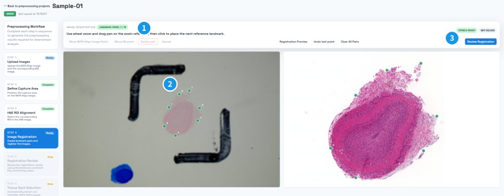
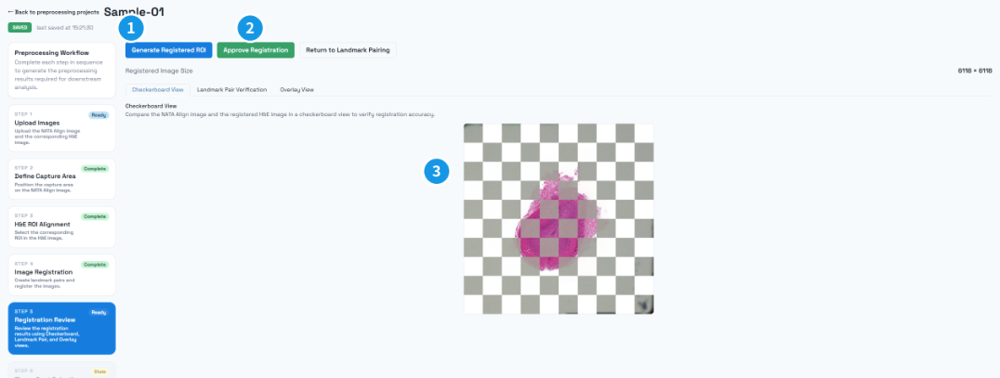
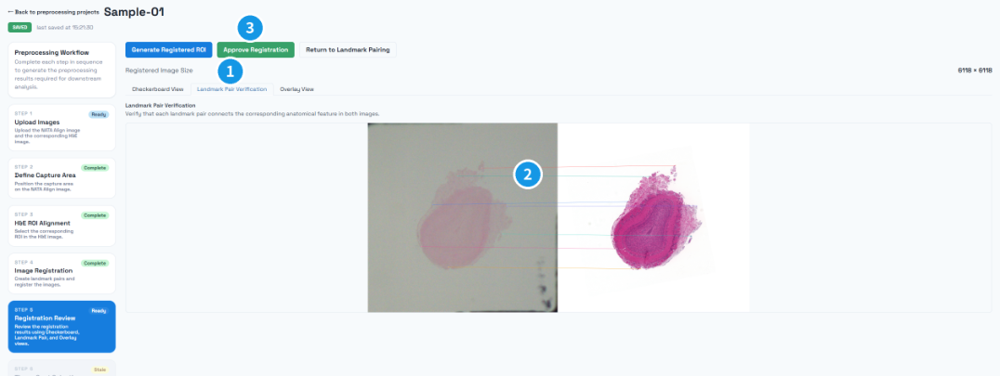
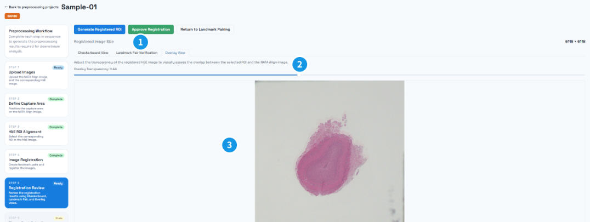
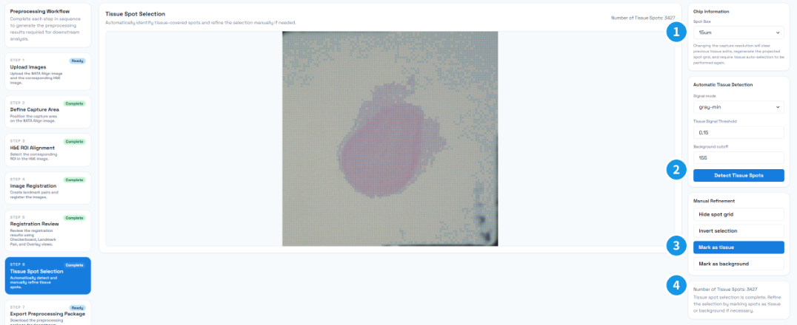
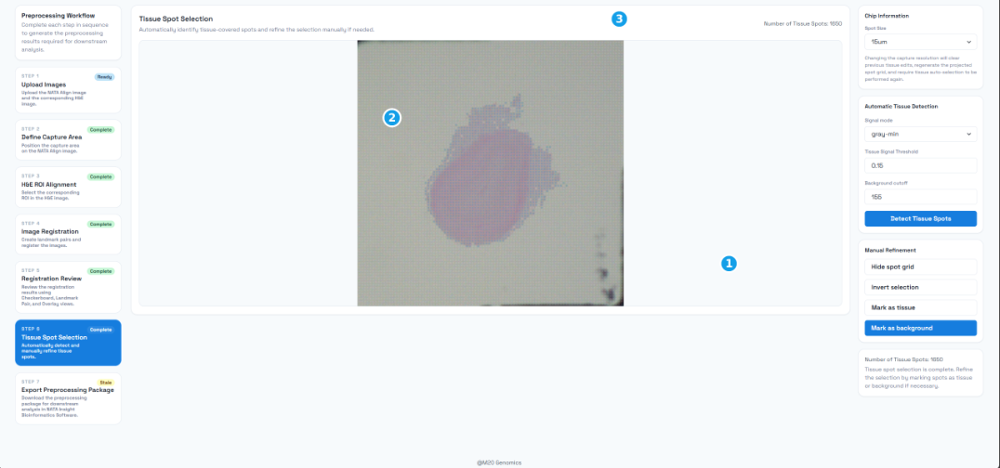

# H&E Image Preprocessing Guide

This guide explains how to use the H&E preprocessing tool to import dual-staining images, localize the chip, align the H&E image, select tissue regions, preview the export, and export preprocessing results. The tool runs locally in the browser. Project drafts and source images are stored only in the current browser.

## 1 Software Requirements

- Minimum browser engine requirement: Chromium 130 or later.
- Recommended clients: Google Chrome v130+ or Microsoft Edge v130+.
- Use a stable desktop environment when processing large pathology images. If a source file is too large, compress or crop it appropriately before importing.

## 2 Software URL

https://spatial.tool.m20genomics.cn/preprocess

## 3 Workspace Entry

Figure 1: ① Create a new preprocessing project; ② import an existing preprocessing package; ③ open a project saved in the current browser.

After opening the page, start or continue H&E preprocessing in one of the following ways:

1. Create preprocess project: Create a new preprocessing project. Enter a project name to enter the workflow. Source images are imported later in the Source step.
2. Import preprocess project: Import a saved preprocessing project package to restore a previous workspace.
3. Saved preprocess projects: Open a project draft saved in the current browser and continue the previous processing progress.

## 4 Generate H&E Preprocessing Files

The preprocessing workflow includes the following steps: Source (Upload Images) → Localize (Define Capture Area) → HE Focus (H&E ROI Alignment) → Align (Image Registration) → Crop (Registration Review) → Tissue (Tissue Spot Selection) → Preview (Export Preview) → Export (Export Preprocessing Package).

### 4.1 Source: Import Source Images

Figure 2: ① Eosin / NATA Align reference image and Replace reference; ② H&E image and Replace image.

Import two types of source images in the Source step:

- Eosin source image / NATA Align image: Import the eosin-stained reference image. This image is used for chip localization and as the reference image for subsequent registration.
- H&E source image: Import the H&E-stained image. This image is used for H&E workspace focusing, feature-point registration, and final export.

To import the files, click Replace reference in the NATA Align image area and Upload HE image or Replace image in the H&E stained tissue image area. Check the file names, pixel dimensions, and previews to confirm that both images come from the same sample and cover the same tissue region.

Import notes:

1. Common browser-decodable image formats are supported, including .tif / .tiff files. Recommended formats are tif, png, jpg, or jpeg.
2. The system generates thumbnails and working images from the source images to improve display and interaction performance in the browser.
3. Replacing either source image preserves the project itself, but invalidates downstream results such as localization, registration, crop, tissue selection, and export. These results must be checked or generated again.

### 4.2 Localize: Chip Localization

Figure 3: ① Green capture/localization box; ② LL orientation marker; ③ zoom, rotation, flip, and reset controls.

The Localize step determines the chip coverage area on the eosin image. Adjust the image and localization box so that the box accurately covers the chip area, and make sure the LL marker corresponds to the lower-left corner direction of the chip.

Main controls:

1. Zoom: Adjust the canvas zoom level to inspect chip boundaries.
2. Rotation: Rotate the image. From left to right, the buttons rotate 90 degrees counterclockwise, 90 degrees clockwise, 1 degree counterclockwise, and 1 degree clockwise.
3. Flip: Flip the image. From left to right, the buttons flip horizontally and vertically.
4. Reset: Reset the current image zoom, rotation, and flip state.
5. Localization box: Drag or resize the localization box so it covers the chip range. The localization result is used as the spatial reference for later H&E focusing, crop generation, and spot projection.

### 4.3 HE Focus: H&E Workspace Focusing

Figure 4: ① H&E working ROI; ② orientation and zoom controls; ③ NATA Align reference image for checking the corresponding tissue.

The HE Focus step determines the workspace area in the H&E image that corresponds to the eosin chip area. After entering this step, an initial square working area is displayed. Use the confirmed eosin chip area as the reference, and manually adjust the image orientation and green focus box so it covers the matching H&E tissue area.

Key operations:

1. Use the zoom, rotation, flip, and Reset controls to adjust the display orientation of the H&E image.
2. Drag or resize the green focus box so that it covers the tissue range in the H&E image corresponding to the eosin chip area.
3. The NATA Align reference image on the right can be used to compare the current H&E focus area with the confirmed eosin chip area.
4. The focus area may be slightly larger than the target area to ensure that tissue boundaries are not missed during later registration and cropping.

### 4.4 Align: Feature-Point Alignment

Figure 5: ① Pair-count prompt; ② corresponding feature points with the same number in both images; ③ Review Registration to compute the registration.

The Align step registers the eosin image and the H&E image using paired feature points. The left canvas shows the Eosin reference, and the right canvas shows the H&E moving image.

Select clear, evenly distributed, and repeatably identifiable tissue structures in both images as feature points. First click a feature point in the eosin image on the left, then click the corresponding position in the H&E image on the right to create one registration pair. Create at least 7 pairs and cover both tissue edges and interiors. Click Review Registration to compute the registration matrix.

Control descriptions:

1. Move NATA Align Image Point: Move the selected feature point in the eosin/reference image. First click the point to adjust, then click this button and place it again.
2. Move HE point: Move the selected feature point in the H&E image. The operation is the same as Move NATA Align Image Point.
3. Delete pair: Delete a pair of feature points. Click a feature point on either side, then click this button to delete the corresponding point pair.
4. Cancel: Cancel the current selection or pending placement state.
5. Registration Preview: Show registration diagnostics to evaluate feature-point quality and registration reliability.
6. Undo last point: Undo the most recently added complete pair.
7. Clear All Pairs: Clear all current point pairs and restart marking.
8. Review Registration: Compute the H&E-to-eosin registration relationship from the marked point pairs.

Diagnostic metrics:

| Metric | Meaning | Recommendation |
|---|---|---|
| Inlier ratio | Percentage of matched points that fit the final geometric model | Higher values indicate fewer incorrect matches |
| Reprojection RMSE | Root mean square reprojection error | Lower values indicate higher registration accuracy |
| Quality gates | Registration quality checks | Proceed to registration review only after all checks pass |

Quality gates include the following checks:

| Check | Meaning |
|---|---|
| minPairs | Whether the number of matching point pairs is sufficient |
| inlier | Whether the inlier ratio meets the requirement |
| rmse | Whether the reprojection error meets the requirement |
| matrix | Whether the computed matrix is valid and not degenerate |
| scale | Whether the estimated scale is within a reasonable range |

In addition to the gates above, feature points must cover a sufficiently wide chip area. If the interface shows Landmark spread is narrow, the points are too concentrated. Add more widely distributed paired points within the tissue area and click Review Registration again. Later tissue selection becomes available only after the registration passes and its review is approved.

### 4.5 Crop: Crop and QC (Registration Review)

After registration is completed, enter the Crop / Registration Review step to generate crop results and perform visual QC. The system maps the H&E image to the eosin chip area according to the registration result and generates preview images for inspection.

#### Tissue Align

Figure 6: ① Generate the registered ROI; ② approve the registration; ③ Checkerboard View, used to check structural continuity across tile boundaries.

Tissue Align / Checkerboard View displays a checkerboard comparison between the eosin crop and the transformed H&E crop. Use it to quickly judge whether the overall tissue structures are aligned.

#### Feature Matches

Figure 7: ① Landmark Pair Verification tab; ② registration-point connection lines; ③ Approve Registration.

Feature Matches / Landmark Pair Verification displays the two cropped images and feature-point connection lines. Use it to check whether the feature-point correspondence is reasonable.

#### Overlay opacity

Figure 8: ① Overlay View tab; ② Overlay Transparency slider; ③ overlay preview area.

Overlay opacity / Overlay View adjusts the transparency of the H&E overlay, making it easier to inspect whether local tissue structures overlap.

QC operations:

1. Click Generate Registered ROI to generate the registered ROI and QC previews.
2. If the tissue structures and feature-point positions in the two images align well, click Approve Registration to mark the registration review as complete and enable the Tissue step. Then enter Tissue from the workflow sidebar on the left.
3. If the alignment result does not meet requirements, click Return to Landmark Pairing to return to the Align step and adjust feature points.

Note: After registration review passes, the system generates projected spots according to the chip configuration. These projected spots are used as the basis for tissue selection in the Tissue step.

### 4.6 Tissue: Tissue Region Selection

Figure 9: ① Spot Size; ② automatic-detection parameters and Detect Tissue Spots; ③ Manual Refinement tools; ④ Number of Tissue Spots.

The Tissue step selects valid tissue regions on projected spots. The system supports both automatic detection and manual spot activation or deactivation.

Main parameters:

1. Spot Size / Chip size: Select the chip size. The current tool supports 15um and 50um chip configurations. Different chips correspond to different spot grids and templates. Changing the size clears existing tissue edits, so confirm it before manual refinement.
2. Automatic Tissue Detection / Auto detection: Automatically identify tissue regions from the cropped eosin image.
   - Signal mode / Threshold mode: Threshold mode.
     - raw: Threshold detection based on image saturation. This is often used for images with obvious stained regions.
     - gray-min: Threshold detection based on the minimum grayscale channel.
     - gray-max: Threshold detection based on the maximum grayscale channel.
   - Tissue Signal Threshold / Activation threshold: Spot activation ratio. The input accepts 0 to 1, while the effective value during automatic detection is limited to 0 to 0.3. If the proportion of pixels inside a spot that meet the threshold condition is lower than this value, the spot is not classified as tissue.
   - Saturation Threshold / Background cutoff: Threshold intensity, ranging from 0 to 255. In raw mode, this is shown as Saturation Threshold; in grayscale modes, it is shown as Background cutoff.
3. Manual Refinement / Selection controls: Manual selection tools.
   - Hide spot grid / Show spot grid: Hide or show the spot grid.
   - Invert selection: Invert the current tissue activation matrix.
   - Mark as tissue: Click a single spot or hold the left button and draw around target spots to mark them as tissue.
   - Mark as background: Click or draw around background areas, tissue holes, or false-positive regions to mark covered spots as background.

It is recommended to run Auto detection first to generate an initial result. After changing a parameter, click Detect Tissue Spots again. Then use Mark as tissue / Mark as background to manually correct tissue edges, blank regions, or false-positive regions. Use the wheel to zoom and hold the middle mouse button while dragging to pan the canvas.

When using Mark as background, first confirm that the tool is selected, then hold the left mouse button and draw along the region to remove. When the button is released, covered spots are deactivated and the spot count is updated. Use Mark as tissue as needed to restore missed tissue spots.

Figure 10a: ① Selected Mark as background; ② red path being drawn; ③ current spot count. Keep the mouse button pressed until drawing is complete.

Figure 10b: ① Mark as background; ② updated spot canvas; ③ updated spot count.

### 4.7 Preview: Export Preview

After tissue region selection is complete, enter the Preview (Export Preview) step before exporting to review three images of identical dimensions side by side:

- Cropped eosin image: The cropped eosin reference image.
- Cropped H&E image: The cropped H&E tissue image.
- Under tissue spot: The standalone spot image. It contains no H&E/eosin tissue background: spots classified as tissue are shown in blue, the remaining spot grid is shown in light gray, and the background is white.

All three images share the registered crop dimensions (the page shows the exact pixel size), so tissue coverage can be compared position by position to confirm that the tissue selection matches the registered crop.

Usage notes:

1. The Preview step becomes available after tissue region selection is complete. If upstream results are missing or invalidated, the page shows the blocking reason; return to the corresponding step and retry after fixing it.
2. The standalone spot image refreshes automatically with the tissue selection results; a placeholder is shown while it is being rendered.
3. After confirming the results, click Continue to export to enter the Export step. The spot_image.png file in the exported package is this standalone spot image.

### 4.8 Export: Export Results

Figure 11: ① Include NATAScope project file; ② Download. To resume editing later, select ① first, then click ②.

The Export step packages preprocessing results as a ZIP file for downstream analysis workflows. To resume editing later, select Include NATAScope project file first. Then click Download to download the result package.

Default export contents:

| File | Description |
|---|---|
| tissue_fullres_image.png | Full-resolution H&E tissue crop |
| tissue_hires_image.png | High-resolution downsampled image |
| tissue_lowres_image.png | Low-resolution downsampled image |
| spot_image.png | Standalone spot image without any H&E tissue background; tissue spots are shown in blue; same dimensions as the H&E crop |
| scalefactors_json.json | Spot diameter and high-/low-resolution scale factors |
| tissue_positions.csv | Spot coordinates, tissue status, and array row/column information |
| tissue_matrix.csv | Tissue activation matrix |
| aligned_tissue_image.png | Checkerboard image for registration review |

Optional export items:

1. Include NATAScope project file: Write the project recovery file and source-image resources into the ZIP so the workspace can later be restored from the landing page through Select Package.

When using an H&E tissue image downstream, choose a tissue_*_image.png file; use spot_image.png when a pure spot map is needed; aligned_tissue_image.png is intended for registration review.

Figure 12: ① derived-assets and source-assets directories used for project recovery; ② result images, JSON, and CSV files. spot_image.png is the standalone spot image. Keep the complete directory structure.

Before exporting, confirm that registration review has passed, the chip configuration is correct, and tissue region selection is complete; the Preview step can be used to verify the export previews. If upstream results are invalidated or required files are missing, the export button is disabled or prompts you to return to the corresponding step for reprocessing.
