# H&E 图像预处理说明

本说明用于指导用户在 H&E 预处理工具中完成双染色图像导入、芯片定位、H&E 图像对齐、组织区域选择、导出预览和结果导出。工具在浏览器本地运行，项目草稿和源图像仅保存在当前浏览器中。

## 1 软件要求

- 最低浏览器内核要求：Chromium 130 或更高版本。
- 推荐客户端：Google Chrome v130+ 或 Microsoft Edge v130+。
- 建议使用性能稳定的桌面环境处理大尺寸病理图像；如源文件过大，可在导入前进行合理压缩或裁剪。

## 2 软件地址

https://spatial.tool.m20genomics.cn/preprocess

## 3 工作区入口

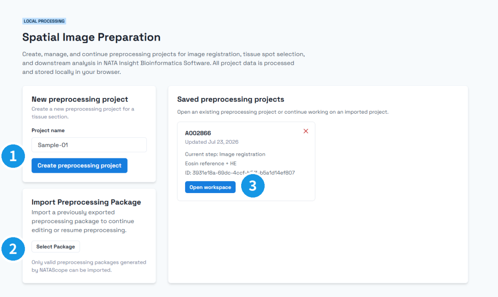

图 1：① 创建新预处理项目；② 导入已有预处理包；③ 打开当前浏览器中保存的项目。

进入页面后，可通过以下方式开始或继续 H&E 预处理工作：

1. Create preprocess project：创建新的预处理项目。输入项目名称后进入工作流，源图像在后续 Source 步骤中导入。
2. Import preprocess project：导入已保存的预处理项目包，用于恢复历史工作区。
3. Saved preprocess projects：打开当前浏览器中保存的项目草稿，继续上一次的处理进度。

## 4 生成 H&E 预处理文件

预处理工作流包括以下步骤：Source（Upload Images）→ Localize（Define Capture Area）→ HE Focus（H&E ROI Alignment）→ Align（Image Registration）→ Crop（Registration Review）→ Tissue（Tissue Spot Selection）→ Preview（Export Preview）→ Export（Export Preprocessing Package）。

### 4.1 Source：导入源图像

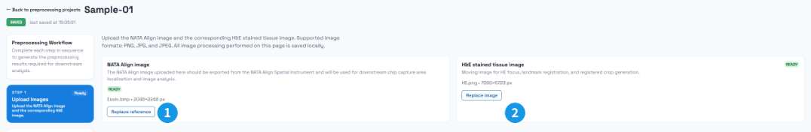

图 2：① 伊红 / NATA Align 参考图像及 Replace reference；② H&E 图像及 Replace image。

在 Source 步骤中导入两类源图像：

- Eosin source image / NATA Align image：导入伊红染色参考图像。该图像用于芯片定位，并作为后续配准的参考图像。
- H&E source image：导入 H&E 染色图像。该图像用于 H&E 工作区域聚焦、特征点配准和最终导出。

操作时在 NATA Align image 区域点击 Replace reference，在 H&E stained tissue image 区域点击 Upload HE image 或 Replace image，并检查文件名、像素尺寸和预览图，确认两张图像来自同一样本且覆盖同一组织区域。

导入说明：

1. 支持常见浏览器可解码图像格式，并支持 .tif / .tiff 文件；推荐使用 tif、png、jpg 或 jpeg。
2. 系统会为源图像生成缩略图和工作图像，以提升浏览器内的显示与交互性能。
3. 替换任一源图像会保留项目本身，但会使定位、配准、裁剪、组织选择和导出等下游结果失效，需要重新检查或生成。

### 4.2 Localize：芯片定位

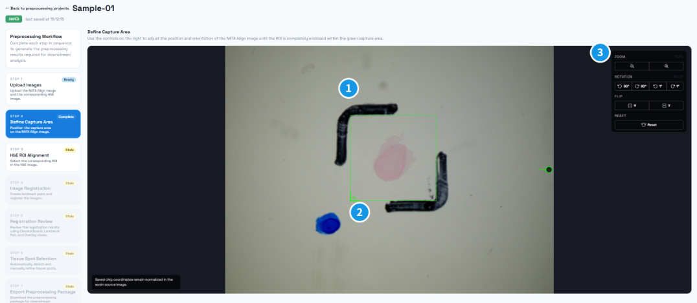

图 3：① 绿色捕获 / 定位框；② LL 方向标记；③ 缩放、旋转、翻转和重置工具。

Localize 步骤用于在伊红图像上确定芯片覆盖范围。请调整图像和定位框，使定位框准确覆盖芯片区域，并让 LL 标记对应芯片左下角方向。

主要控件说明：

1. Zoom：调整画布缩放比例，便于观察芯片边界。
2. Rotation：旋转图像。按钮从左到右依次为逆时针 90°、顺时针 90°、逆时针 1°、顺时针 1°。
3. Flip：翻转图像。按钮从左到右依次为水平翻转、垂直翻转。
4. Reset：重置当前图像的缩放、旋转和翻转状态。
5. 定位框：拖动或缩放定位框，使其覆盖芯片范围。定位结果会作为后续 H&E 聚焦、裁剪和 spot 投影的空间基准。

### 4.3 HE Focus：H&E 工作区域聚焦

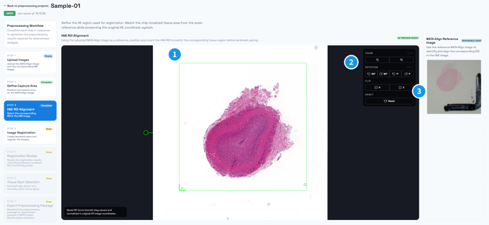

图 4：① H&E 工作 ROI；② 方向和缩放工具；③ NATA Align 参考图像，用于核对对应组织。

HE Focus 步骤用于在 H&E 图像中确定与伊红芯片区域对应的工作区域。进入该步骤后，画布会显示一个初始方形工作区域；请以已确认的伊红芯片区域为参考，手动调整图像方向和绿色聚焦框。

操作要点：

1. 使用缩放、旋转、翻转和 Reset 控件调整 H&E 图像显示方向。
2. 拖动或缩放绿色聚焦框，使其覆盖 H&E 图像中与伊红芯片区域对应的组织范围。
3. 右侧的 NATA Align 参考图像可作为参考，用于比较当前 H&E 聚焦区域与已确认的伊红芯片区域。
4. 聚焦区域允许略大于目标区域，以保证后续配准和裁剪不会遗漏组织边界。

### 4.4 Align：特征点对齐

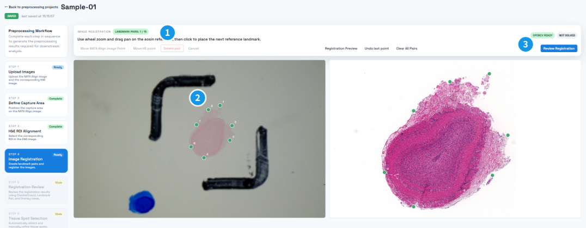

图 5：① 点对数量提示；② 两张图像中同编号的对应特征点；③ Review Registration 计算配准。

Align 步骤通过成对特征点将伊红图像与 H&E 图像进行配准。画布左侧为 Eosin reference，右侧为 H&E moving image。

推荐在两张图中选择清晰、分布均匀且可重复识别的组织结构作为特征点。先在左侧伊红图像点击一个特征点，再在右侧 H&E 图像中点击对应位置，形成一对配准点。至少建立 7 对点，并使点位覆盖组织边缘和内部；点击 Review Registration 计算配准矩阵。

控件说明：

1. Move NATA Align Image Point：移动已选中的伊红 / 参考图像特征点。先点击需要调整的点，再点击该按钮并重新放置。
2. Move HE point：移动已选中的 H&E 图像特征点，操作方式同 Move NATA Align Image Point。
3. Delete pair：删除一对特征点。点击任意一侧的特征点后，再点击该按钮即可删除对应点对。
4. Cancel：取消当前选中或待放置状态。
5. Registration Preview：查看配准诊断信息，用于判断特征点质量和配准结果是否可靠。
6. Undo last point：撤销最近一次添加的完整点对。
7. Clear All Pairs：清空当前所有配对点，重新开始标记。
8. Review Registration：根据已标记的点对计算 H&E 到伊红图像的配准关系。

诊断指标说明：

| 指标 | 含义 | 建议 |
|---|---|---|
| Inlier ratio | 符合最终几何模型的匹配点占比 | 数值越高，说明错误匹配越少 |
| Reprojection RMSE | 重投影均方根误差 | 数值越小，说明配准精度越高 |
| Quality gates | 配准质量检查项 | 全部通过后再进入配准审核 |

Quality gates 包含以下检查项：

| 检查项 | 含义 |
|---|---|
| minPairs | 匹配点对数量是否足够 |
| inlier | 内点比例是否达标 |
| rmse | 重投影误差是否达标 |
| matrix | 计算得到的矩阵是否有效且未退化 |
| scale | 估计尺度是否处于合理范围 |

除上述门禁外，特征点还需要覆盖足够宽的芯片区域。如果界面提示 Landmark spread is narrow，说明点位分布过于集中；请在组织区域内增加更分散的配对点后重新点击 Review Registration。只有配准通过并完成审核后，后续组织选择才会启用。

### 4.5 Crop：裁剪与 QC（配准审核）

配准完成后，进入 Crop / Registration Review 步骤生成裁剪结果并进行目视 QC。系统会将 H&E 图像按配准结果映射到伊红芯片区域，并生成用于检查的预览图。

#### Tissue Align

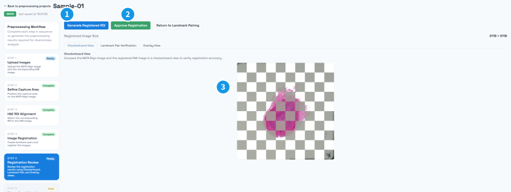

图 6：① 生成配准 ROI；② 批准配准结果；③ Checkerboard View，用于检查交界处的结构连续性。

Tissue Align / Checkerboard View 显示伊红裁剪图与变换后的 H&E 裁剪图的棋盘格对照，用于快速判断整体组织结构是否对齐。

#### Feature Matches

图 7：① Landmark Pair Verification 标签；② 配准点连线；③ Approve Registration。

Feature Matches / Landmark Pair Verification 显示两张裁剪图和特征点连线，用于检查特征点对应关系是否合理。

#### Overlay opacity

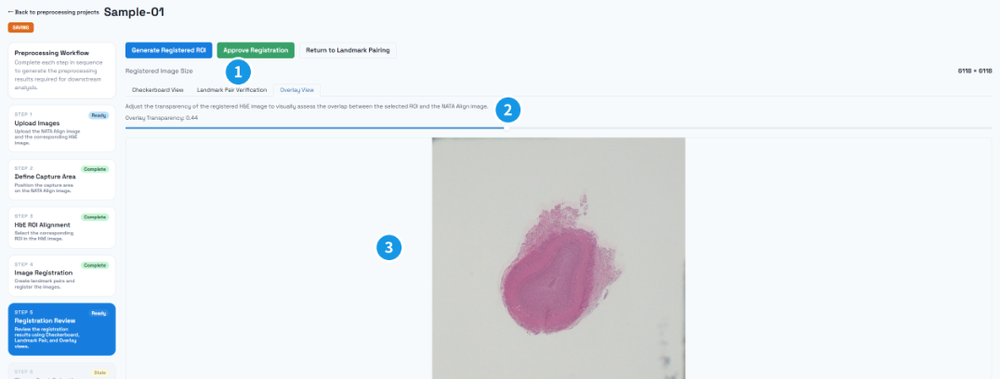

图 8：① Overlay View 标签；② Overlay Transparency 滑条；③ 叠加预览区域。

Overlay opacity / Overlay View 用于调节 H&E 叠加层透明度，便于观察局部组织结构是否重合。

QC 操作：

1. 点击 Generate Registered ROI 生成配准后的 ROI 和 QC 预览。
2. 若两张图的组织结构和特征点位置对齐良好，点击 Approve Registration 将配准审核标记为完成并启用 Tissue 步骤；随后在左侧流程栏进入 Tissue。
3. 若对齐结果不满足要求，点击 Return to Landmark Pairing 返回 Align 步骤重新调整特征点。

说明：配准审核通过后，系统会根据芯片配置生成 projected spots，作为 Tissue 步骤中组织选择的基础。

### 4.6 Tissue：组织区域选择

图 9：① Spot Size；② 自动检测参数和 Detect Tissue Spots；③ Manual Refinement 工具；④ Number of Tissue Spots。

Tissue 步骤用于在 projected spots 上选择有效组织区域。系统支持自动检测，也支持手动激活或取消 spot。

主要参数说明：

1. Spot Size / Chip size：选择芯片尺寸。当前支持 15um 和 50um 芯片配置；不同芯片对应不同的 spot 网格和模板。更换规格会清除已有组织编辑，应在人工精修前确认。
2. Automatic Tissue Detection / Auto detection：根据裁剪后的伊红图像自动识别组织区域。
   - Signal mode / Threshold mode：阈值模式。
     - raw：基于图像饱和度进行阈值检测，常用于染色区域较明显的图像。
     - gray-min：基于最小灰度通道进行阈值检测。
     - gray-max：基于最大灰度通道进行阈值检测。
   - Tissue Signal Threshold / Activation threshold：spot 激活比例。输入值允许 0 到 1，自动检测时有效值会限制在 0 到 0.3。若某个 spot 内满足阈值条件的像素比例低于该值，则不会被判定为组织区域。
   - Saturation Threshold / Background cutoff：阈值强度，取值范围为 0 到 255。raw 模式下显示为 Saturation Threshold，灰度模式下显示为 Background cutoff。
3. Manual Refinement / Selection controls：手动选择工具。
   - Hide spot grid / Show spot grid：隐藏或显示 spot 网格。
   - Invert selection：反选当前组织激活矩阵。
   - Mark as tissue：单击单个 spot，或按住左键圈画，将覆盖到的 spot 标记为组织。
   - Mark as background：单击或圈画背景、组织孔洞或误检区域，将覆盖到的 spot 标记为背景。

建议先运行 Auto detection 生成初始结果；修改参数后需再次点击 Detect Tissue Spots。随后使用 Mark as tissue / Mark as background 对边缘组织、空白区域或误检区域进行人工修正。滚轮用于缩放，按住鼠标中键拖动可平移画布。

使用 Mark as background 时，先确认工具处于选中状态，再按住鼠标左键沿需要取消的区域绘制路径；松开鼠标后路径覆盖的 spot 会被取消选中，数量随之更新。必要时使用 Mark as tissue 补回遗漏组织。

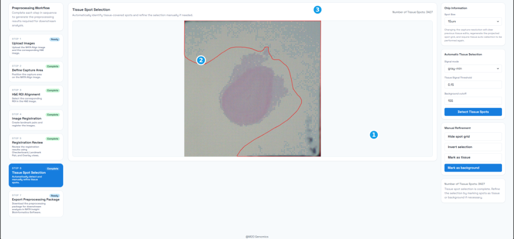

图 10a：① 选中的 Mark as background；② 正在绘制的红色路径；③ 当前 spot 数量。绘制完成前请保持鼠标按下。

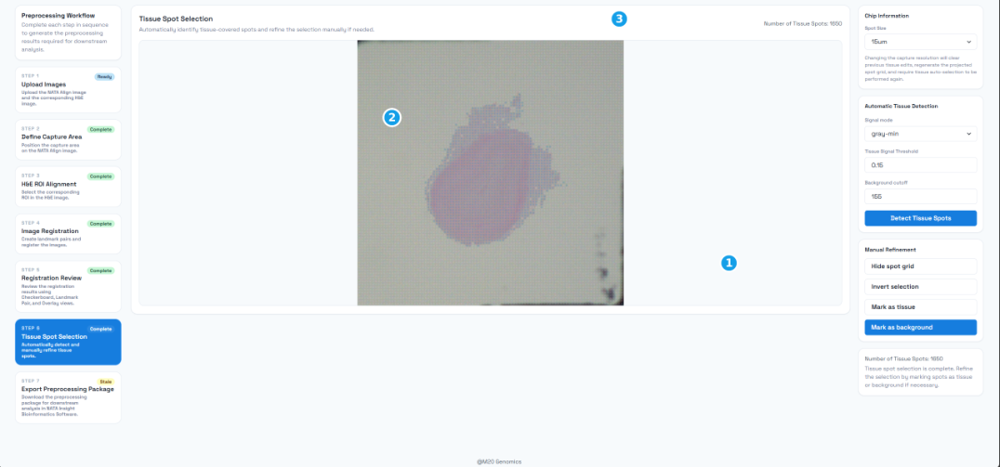

图 10b：① Mark as background；② 更新后的 spot 画布；③ 更新后的 spot 数量。

### 4.7 Preview：导出预览

组织区域选择完成后，可在导出前进入 Preview（Export Preview）步骤，对三幅同尺寸图像进行并排核对：

- Cropped eosin image：裁剪后的伊红参考图。
- Cropped H&E image：裁剪后的 H&E 组织图。
- Under tissue spot：独立 spot 图。该图不包含任何 H&E / 伊红组织背景：判定为组织的 spot 以蓝色显示，其余 spot 网格以浅灰色显示，背景为白色。

三幅图像共享同一配准裁剪尺寸（页面会标注具体像素尺寸），可逐位置比对组织覆盖情况，确认组织选择结果与配准裁剪是否一致。

使用说明：

1. Preview 步骤在组织区域选择完成后启用；若上游结果缺失或已失效，页面会显示阻塞原因，需返回对应步骤处理后重试。
2. 独立 spot 图随组织选择结果自动刷新；渲染期间会显示占位提示。
3. 确认无误后，点击 Continue to export 进入 Export 步骤执行导出。导出包中的 spot_image.png 即该独立 spot 图。

### 4.8 Export：导出结果

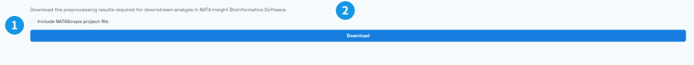

图 11：① Include NATAScope project file；② Download。需要恢复编辑时先勾选 ①，再点击 ②。

Export 步骤将预处理结果打包为 ZIP 文件，用于后续分析流程。如需以后恢复编辑，先勾选 Include NATAScope project file；再点击 Download 下载结果包。

默认导出内容包括：

| 文件 | 说明 |
|---|---|
| tissue_fullres_image.png | 全分辨率 H&E 组织裁剪图 |
| tissue_hires_image.png | 高分辨率降采样图 |
| tissue_lowres_image.png | 低分辨率降采样图 |
| spot_image.png | 独立 spot 图（无 H&E / 伊红组织背景；蓝色为组织 spot，与 H&E 裁剪图同尺寸） |
| scalefactors_json.json | spot 直径和高低分辨率缩放系数 |
| tissue_positions.csv | spot 坐标、组织状态和阵列行列信息 |
| tissue_matrix.csv | 组织激活矩阵 |
| aligned_tissue_image.png | 配准审核用棋盘格图像 |

可选导出项：

1. Include NATAScope project file：将项目恢复文件和源图像资源一并写入 ZIP，后续可在入口页面通过 Select Package 恢复工作区。

下游使用 H&E 组织图像时，请选择 tissue_*_image.png；需要纯 spot 分布图时使用 spot_image.png；aligned_tissue_image.png 用于配准检查。

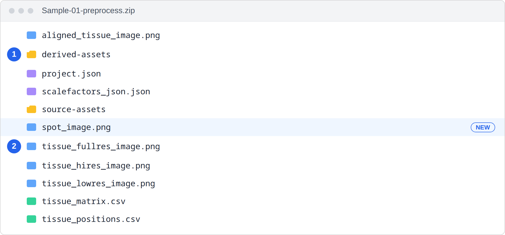

图 12：① 用于恢复项目的 derived-assets 和 source-assets 目录；② 结果图像、JSON 和 CSV 文件。其中 spot_image.png 为独立 spot 图。请保留完整目录结构。

导出前请确认配准审核已通过、芯片配置正确、组织区域选择结果已完成，并可在 Preview 步骤核对导出预览。若上游结果失效或缺少必要文件，导出按钮会被禁用或提示需要返回对应步骤重新处理。
